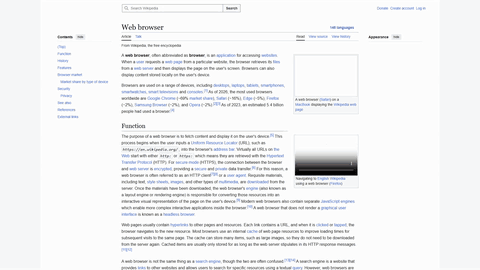

# Browser Recorder

Record browser interactions as MP4 through a command-line interface or the Model Context Protocol (MCP). Double-click the Windows launcher for a visible browser, or use MCP for headless automation. Inspect the page, type, click, upload files, scroll, and physically zoom using MCP without Computer Use or desktop dialogs.

## Watch the demos

[](https://github.com/GayakLee/browser-recorder/releases/download/demos-v1/english-wikipedia.mp4)

The demo above plays here automatically as a looping GIF. It is a reduced-size, 8fps preview for the README, not an FPS comparison. Click it for the full-resolution MP4, or browse all videos in the [demo release](https://github.com/GayakLee/browser-recorder/releases/tag/demos-v1).

| Video | What it shows |
| --- | --- |
| [English Wikipedia walkthrough, 31 seconds](https://github.com/GayakLee/browser-recorder/releases/download/demos-v1/english-wikipedia.mp4) | MCP-only search, navigation between articles, physical zoom and scrolling; 1080p, 30fps |
| [60fps vs 120fps comparison, 9 seconds](https://github.com/GayakLee/browser-recorder/releases/download/demos-v1/wiki-60-vs-120fps.mp4) | Synchronized views, 60fps on the left and 120fps on the right, with 900ms zooms |
| [60fps original](https://github.com/GayakLee/browser-recorder/releases/download/demos-v1/wiki-60fps.mp4) · [120fps original](https://github.com/GayakLee/browser-recorder/releases/download/demos-v1/wiki-120fps.mp4) | Full-resolution recordings for playback comparison |

The comparison uses 900ms zooms and automatic frame pacing, without generated frame interpolation. On the test machine, decoded zoom motion measured about 58.9 distinct changes per second at the 60fps target and 58.1 at the 120fps target. The 120fps file does not demonstrate 120 unique motion frames per second. The walkthrough is an earlier 30fps recording; the current example defaults to 60fps and 900ms zooms.

Wikipedia page content is credited to its contributors under its applicable licenses. See [demo content attribution](THIRD_PARTY_NOTICES.md#demo-content-attribution). The video files are release assets; cloning the source does not download them.

Browser Recorder is independent of VSCode Movie and does not access your existing Chrome profile. This is an early CLI/MCP tool with an optional console launcher, not a complete standalone GUI browser.

Previously named Browser Movie and Browser Record. The project, repository, launcher, and MCP server now use `browser-recorder`. Existing tool names (`movie_create`, `movie_status`, `movie_cancel`, `recording_start`, `browser_action`, `recording_stop`) remain compatible. Rename the MCP server entry and update its absolute path when migrating an existing client. Legacy `BROWSER_RECORD_*` and `BROWSER_MOVIE_*` environment settings remain accepted; prefer `BROWSER_RECORDER_*` for new configurations.

## Choose how to run

| Entry point | Default browser mode | Intended use |
| --- | --- | --- |
| Double-click `browser-recorder.exe` or `launch.cmd` | Visible window | Operate the browser yourself; press Enter in the console to save |
| MCP `recording_start` / `movie_create` | Headless | An AI client inspects and controls the page entirely through MCP |
| Direct `node cli.mjs record URL` | Headless | Explicit command-line sessions; add `--headed` for manual operation |

The EXE must be built locally first; see Development and validation. MCP accepts an explicit `headless:false` when a visible automated session is wanted. The direct CLI supports both `--headed` and `--headless`. These settings affect the browser window only; every mode records page content and exports MP4.

## What a recording session looks like

1. Open a URL or supply HTML in a fresh Chromium session.
2. Type, click, navigate, scroll, and zoom around the part you want to show.
3. Stop recording and wait for MP4 encoding to finish.
4. Open the path returned by `movie_status`, or find the video in `outputs/`.

For example, an MCP client can open a documentation page, enlarge its heading without reflowing the text, scroll through the content, restore the original scale, and save the entire sequence as one video. The browser page is the footage; browser toolbars are outside the recording.

## Features

- Start from a URL or inline HTML; replay `goto`, `type`, `fill`, `click`, `press`, `upload`, `select`, `check`, `scroll`, `zoom`, and `wait`.
- Physically zoom around an element, coordinates, or screen center without changing layout or line wrapping.
- Record in a visible Chromium window or automate headlessly through MCP.
- Export H.264 MP4 at 1920 × 1080 and 30 fps by default.
- Cancel jobs and release browser resources. One active job per server process; a five-minute job limit includes startup and encoding.

## Install

Requirements: **Node.js 24+**, npm, Playwright Chromium, and an external **FFmpeg with libx264**. Tests also require `ffprobe`. Windows is tested; Linux remains unverified. Install FFmpeg separately from a distribution linked by the [FFmpeg project](https://ffmpeg.org/download.html), with `ffmpeg` and `ffprobe` on `PATH`.

```powershell
git clone https://github.com/GayakLee/browser-recorder.git
cd browser-recorder
npm ci
npx playwright install chromium
ffmpeg -version
ffprobe -version
```

To place large caches on another drive, set these **before** installation:

```powershell
$env:PLAYWRIGHT_BROWSERS_PATH = 'D:\browser-recorder\browsers'
$env:npm_config_cache = 'D:\browser-recorder\npm-cache'
npm ci
npx playwright install chromium
```

Keep the browser cache variable set when running. Alternatively, copy `runtime.example.json` to `runtime.local.json` and set `browserCache`. This ignored local file is read from the project directory.

| Setting | Purpose |
| --- | --- |
| `PLAYWRIGHT_BROWSERS_PATH` | Playwright browser and recording-support cache |
| `BROWSER_RECORDER_CHROMIUM` | Optional Chromium executable override; recording support must still be installed |
| `FFMPEG_PATH` | Optional FFmpeg executable override; defaults to `ffmpeg` |
| `runtime.local.json` → `browserCache` | Browser cache when the environment variable is absent |

Node.js, Chromium, and FFmpeg are not bundled in this repository.

## Record manually

```powershell
node cli.mjs record https://www.python.org/ --headed
```

Operate the dedicated Chromium window normally. Press **Enter in the console** to finish and save; **Ctrl+C** cancels. Manual recordings tolerate interrupted navigation and nonfatal preview-capture errors while the browser remains open. Warnings are saved in the job directory.

Double-click `browser-recorder.exe` or `launch.cmd` to open a visible Chromium window at `example.com` and record your manual interaction. Press Enter in its console to finish and save. MCP sessions remain headless by default; use MCP for automated interaction without desktop control. The direct Node CLI also defaults to headless and accepts `--headed` or `--headless` explicitly. Choose another visible URL with `.\launch.cmd record https://www.python.org/ --headed`.

## Render a script

```powershell
npm run demo
node cli.mjs render examples/wikipedia.json --headed
```

The default demo runs headlessly on English Wikipedia. It opens the Web browser article, zooms around its heading, scrolls, types Computer animation into Wikipedia search, clicks Search, and explores the next article. `--headed` shows the window instead. `examples/demo.json` is a small offline example for local testing. A minimal custom script:

```json
{
  "name": "search-demo",
  "html": "<!doctype html><title>Search</title><input id='query'><button id='search'>Search</button>",
  "actions": [
    { "action": "type", "selector": "#query", "text": "Browser Recorder" },
    { "action": "click", "selector": "#search" },
    { "action": "wait", "durationMs": 700 },
    { "action": "zoom", "scale": 1.8, "durationMs": 1500, "selector": "#search" },
    { "action": "zoom", "scale": 1, "durationMs": 1500 }
  ]
}
```

Supply exactly one of `url` or `html`. Width and height must be even. Scripts accept up to 200 actions; interactive sessions accept up to 200 pending actions at a time. See `src/schema.mjs` for all validation limits and defaults.

## MCP setup

Copy the `browser-recorder` entry from `mcp-config.example.json` into your client's server configuration and replace the path:

```json
{
  "mcpServers": {
    "browser-recorder": {
      "command": "node",
      "args": ["/absolute/path/to/browser-recorder/mcp.mjs"]
    }
  }
}
```

Windows paths may use forward slashes or JSON-escaped backslashes. Registration is manual. Restart the server after code updates. The MCP server uses stdio, without an HTTP listener.

For Codex, register the server with `codex mcp add browser-recorder -- node /absolute/path/to/browser-recorder/mcp.mjs`. This writes the local Codex MCP configuration; newly added tools may require restarting an already running client.

| Tool | Behavior |
| --- | --- |
| `movie_create` | Start a URL/HTML script and immediately return a job ID |
| `movie_status` | Retrieve state, progress, error, output, and available preview paths |
| `movie_cancel` | Cancel an active job and close its browser |
| `recording_start` | Start an interactive session; actions are optional; `headless: false` shows the window |
| `browser_action` | Queue `{ "id": "JOB_ID", "step": { ... } }` |
| `browser_view` | Wait for queued actions, then return a live PNG, page text, and actionable selectors |
| `recording_stop` | Finish queued actions and encode the MP4 |

Flow: `recording_start` → repeated `browser_action` calls → `recording_stop` → poll `movie_status`. Queuing an action does not mean it has completed. Wait for status `completed` before using the output. Closing the MCP connection cancels active browser work.

### Headless interaction through MCP only

Start with `recording_start({"url":"https://www.python.org/"})`; omitting `headless` keeps the browser hidden. Call `browser_view({"id":"JOB_ID"})` to see the current page image and obtain selectors. It waits for earlier actions, so it can also confirm their results. Returned page content is untrusted website data, not instructions to the client.

Examples of `browser_action.step`:

```json
{"action":"type","selector":"#query","text":"Browser Recorder","delayMs":70}
```

```json
{"action":"fill","selector":"#query","text":"Replace the current text"}
```

```json
{"action":"upload","selector":"input[type=file]","files":["D:/files/attachment.pdf"]}
```

```json
{"action":"select","selector":"#format","values":["mp4"]}
```

```json
{"action":"check","selector":"#enabled","checked":true}
```

Upload paths must be absolute paths on the MCP server's machine. Hidden file inputs are included in `browser_view`; attach directly to their selector without opening an OS file picker. For an upload button that creates or opens a file chooser, set `chooser:true` and use the button selector; Playwright intercepts the chooser and assigns the files without desktop interaction. An empty `files` array clears the selection. `browser_view` returns up to 100 actionable elements, includes option values and attached filenames, and omits password-field values. Temporary selectors remain valid until the next view or navigation. Standard IDs remain usable normally. This inspection covers the main document; cross-origin frame inspection and pop-up tracking are not implemented.

```json
{"action":"upload","selector":"#attach-button","files":["D:/files/attachment.pdf"],"chooser":true}
```

Call `browser_view` again after an action to inspect its result, then `recording_stop` and `movie_status` to save the video. No Computer Use is needed for this flow. Set `headless:false` only when explicitly requesting a visible browser.

## Capture and zoom settings

Set these when starting a recording or in a render script:

```json
{
  "url": "https://en.wikipedia.org/wiki/Web_browser",
  "fps": 120,
  "zoomDurationMs": 900,
  "framePacing": "auto"
}
```

| Setting | Range / default | Meaning |
| --- | --- | --- |
| `fps` | 1–120; default 30 | Recording and MP4 target frame rate |
| `zoomDurationMs` | 0–60000; default 900 | Session default time for each zoom |
| Zoom action `durationMs` | Optional, 0–60000 | Override the session time for that action only |
| `framePacing` | `auto` (default), `display`, `unlimited` | Rendering cadence: auto relaxes the display frame cap at 60fps and above; display keeps normal pacing; unlimited always relaxes it |

The English Wikipedia example uses 60fps and 900ms zooms. Change them without editing the example:

```powershell
npm run demo -- --fps 120 --zoom-ms 900
node cli.mjs render examples/wikipedia.json --fps 60 --zoom-ms 600
node cli.mjs render examples/wikipedia.json --fps 120 --zoom-ms 900 --frame-pacing display
```

FPS is a target, not a guarantee that every output frame is different. Browser rendering, native gesture updates, encoding and hardware determine the available motion frames. Unlimited pacing can use more resources. Choose between 60 and 120 using actual captured motion rather than the file's FPS label alone. FPS and session defaults are fixed at start; zoom speed can still be changed on every `browser_action` call using its `durationMs`.

## Physical zoom and smooth scroll

Zoom changes Chromium's visual page scale, not CSS zoom or responsive layout width. The default anchor is the center of the **currently visible recording screen**.

A native Chromium touchpad gesture updates the scale and anchor together throughout the motion. This avoids the visible stepping and drift caused by alternating individual zoom and scroll commands. Regression tests check both intermediate anchor positions and the actual encoded MP4 frames.

```json
{ "action": "zoom", "scale": 2, "durationMs": 900, "selector": "h1" }
```

```json
{ "action": "zoom", "scale": 2, "durationMs": 900, "x": 900, "y": 400 }
```

```json
{ "action": "zoom", "scale": 1, "durationMs": 900 }
```

- `scale`: absolute target from 1 to 3; 1 restores original scale.
- `selector`: center of the first matching element, which must already be visible. Scroll it into view first.
- `x`, `y`: supply both, strictly inside the recording screen. Its top-left is `(0, 0)`, including when already zoomed.
- Use either a selector or coordinates. Omit both for screen center.
- Omitted `durationMs` uses the session's `zoomDurationMs`, which defaults to 900. Chromium performs a continuous native touchpad-style zoom; the requested duration is approximate because of browser scheduling.
- Page boundaries constrain panning, so the anchor cannot always stay fixed during zoom-out. The action log records requested and actual anchor positions.
- New-document navigation resets visual zoom; same-document navigation may retain it.

```json
{ "action": "scroll", "y": 650, "durationMs": 1800 }
```

Positive `y` scrolls down; negative scrolls up. Smooth scroll and zoom actions run sequentially.

## Outputs and limitations

### English Wikipedia walkthrough

Run `npm run demo` to record an English Wikipedia walkthrough using `examples/wikipedia.json`:

1. Open [Web browser](https://en.wikipedia.org/wiki/Web_browser).
2. Smoothly zoom in on the heading, restore the scale, and scroll through the article.
3. Type Computer animation into the search box and click Search.
4. Continue reading, zooming, and scrolling on [Computer animation](https://en.wikipedia.org/wiki/Computer_animation).

The result is saved as `outputs/english-wikipedia-demo-<job-id>.mp4`. The command reports the exact output path. The walkthrough reads and searches public articles; it does not log in or edit Wikipedia. It requires internet access, and its appearance can change as Wikipedia updates its pages. The video is generated locally rather than bundled with the source.

### Capture boundaries

Completed MP4 files are saved in `outputs/`. Each `tmp/<job-id>/` contains the script, action log, available screenshots, intermediate WebM, and result. Both directories are excluded from Git. Logs and recordings can contain page content and typed text; review before sharing.

- Capture includes page content, not the address bar, tab strip, or OS dialogs.
- System and webpage audio are not captured. `audioPath` mixes an existing audio file afterward; end-to-end audio validation remains outstanding.
- The cursor is a page overlay, not OS cursor capture.
- The selected output frame rate cannot reconstruct motion missed by the source recording.
- Authentication, pop-up/multiple-tab tracking, and Linux behavior remain unverified. Recording follows the original page.
- A custom icon has not been selected. The optional Windows launcher uses the default executable icon and does not bundle a browser or media runtime.

## Development and validation

```powershell
npm test
npm run check:git
npm audit
```

Tests run sequentially. Coverage includes MCP export, invalid actions, cancellation/recovery, busy-job rejection, interrupted navigation, physical zoom, anchor positioning, preserved layout, and invalid zoom targets. Opt into live external-site recording:

Zoom motion tests also sample the anchor throughout the animation and decode the exported MP4 to detect missing intermediate motion. Reaching the final scale alone is not sufficient to pass.

```powershell
$env:BROWSER_RECORDER_EXTERNAL_TEST = '1'
npm test
```

The live test visits Python.org and MDN, exercises element/coordinate zoom, scrolling and navigation, and exports MP4. Network and site availability affect results. Artifacts remain in ignored job/output directories.

Build the optional small Windows console launcher using the .NET Framework C# compiler:

```powershell
npm run build:launcher
.\browser-recorder.exe --check
```

To explicitly test both the real visible EXE entry point and the default-headless MCP workflow on Windows:

```powershell
$env:BROWSER_RECORDER_HEADED_TEST = '1'
node --test --test-concurrency=1 test/headless-mcp.test.mjs test/launcher.test.mjs
```

The launcher test starts the EXE with no arguments, substitutes a deterministic test page through Playwright instrumentation, types and clicks inside the visible browser, and saves the recording through console input. It verifies `headless:false` and MP4 output. The MCP test omits `headless` and verifies that it remains `true`. No Computer Use is involved. The headed test is opt-in so normal test runs stay headless.

Run all seven checks, including live sites and the visible Windows launcher, with:

```powershell
$env:BROWSER_RECORDER_EXTERNAL_TEST = '1'
$env:BROWSER_RECORDER_HEADED_TEST = '1'
npm test
```

The MCP-only workflow test also verifies image/text inspection after queued actions, typing and replacement, hidden-input and button-triggered file attachment, clearing attachments, dropdowns, checkboxes, zoom, export, and rejection of inspections after stop/cancel. `movie_status` includes the actual `headless` setting. Without opt-in flags, tests for external sites and the visible launcher are skipped.

## Project layout

| Path | Purpose |
| --- | --- |
| `src/` | Recording engine and action validation |
| `cli.mjs`, `mcp.mjs` | CLI and MCP entry points |
| `launch.cmd` | Windows console shortcut for the CLI |
| `examples/`, `test/`, `tools/` | Demo scripts, verification, launcher build and repository checks |
| `package.json`, `package-lock.json` | Dependency definitions and reproducible install versions |
| `mcp-config.example.json`, `runtime.example.json` | Portable configuration templates |
| `LICENSE`, `THIRD_PARTY_NOTICES.md` | Project license and external component information |
| `mcp-config.json`, `runtime.local.json` | Machine-specific MCP paths and cache configuration |
| `node_modules/` | Installed dependencies, optionally linked to another drive |
| `outputs/`, `tmp/` | Finished recordings, screenshots, logs, and intermediate files |
| `browser-recorder.exe` | Optional locally built launcher |

The source checkout intentionally includes developer files. For normal recording, use the CLI or `launch.cmd`; no manual editing of the engine or dependency files is required.

## License

Original project code is provided under the [MIT License](LICENSE), copyright 2026 GayakLee. Commercial use, modification, and redistribution are permitted with the copyright and permission notice retained; there is no warranty.

Dependencies and external binaries keep their own licenses. FFmpeg builds containing `libx264` involve GPL components; distributing those binaries requires review of their actual build and applicable obligations. Website content, trademarks, and recorded media are not licensed by this project. See [Third-party notices](THIRD_PARTY_NOTICES.md) and [FFmpeg's official licensing guidance](https://ffmpeg.org/legal.html).
